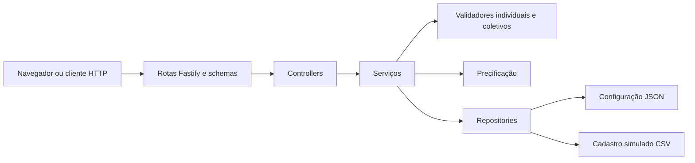
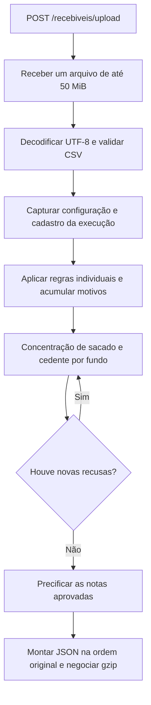
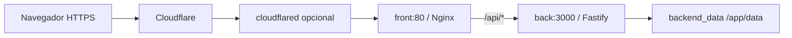

# Backend Antecipe

API de análise e precificação de recebíveis em Node.js, TypeScript e Fastify. Requer Node.js 22 ou superior.

O [manual técnico e a arquitetura](#manual-técnico-e-arquitetura) estão ao final deste documento.

```bash
cd hackathon-kanastra/back
cp .env.example .env
npm ci
npm run dev
```

O servidor escuta na porta `3000`. As variáveis de ambiente `PORT` e `HOST` permitem alterar a porta e o endereço de escuta (padrão: `0.0.0.0`).

O CORS permite qualquer origem (`Access-Control-Allow-Origin: *`) para os métodos `GET`, `POST`, `PUT` e `OPTIONS`, incluindo preflight. Requisições CORS com credenciais não estão habilitadas.

Para compilar e executar:

```bash
npm run build
npm start
```

Encerre o servidor com `Ctrl+C`.

## Documentação da API

Consulte o [guia das rotas em Markdown](../docs/rotas.md) para exemplos de requisição, resposta e erros.

Com o servidor iniciado, acesse [Swagger UI](http://localhost:3000/docs) para consultar e testar as rotas. A especificação OpenAPI está disponível em `/docs/json` e `/docs/yaml`.

| Método | Rota | Descrição |
| --- | --- | --- |
| POST | `/recebiveis/upload` | Envia um CSV no campo `file` e recebe a análise calculada das notas. |
| GET | `/validadores` | Consulta a configuração atual. |
| PUT | `/validadores` | Valida e substitui a configuração completa. |

O Swagger inclui os formatos de requisição, exemplos, respostas de sucesso e erros `400`, `413`, `415` e `500`, conforme a rota. A operação PUT altera o arquivo de configuração também quando executada pela documentação.

## Upload de CSV

`POST /recebiveis/upload` recebe um arquivo no campo `file` de um formulário `multipart/form-data` (limite de 50 MiB).

```bash
curl -X POST http://localhost:3000/recebiveis/upload \
  -F 'file=@../../estoque_antecipe.csv'
```

O controller interpreta o CSV em UTF-8, separado por `;`, com suporte a BOM, campos entre aspas, aspas escapadas e quebras de linha LF/CRLF. Verifica o cabeçalho e a quantidade de campos, mantendo os valores como strings.

Cada CSV válido é analisado pelo `AnaliseService`: primeiro as regras individuais ativas, depois as concentrações de sacado e cedente por fundo. A resposta contém uma classificação para cada nota enviada, na ordem original. O gabarito não é consultado pelo endpoint.

Arquivo ausente ou CSV inválido retorna `400`; conteúdo que não seja multipart retorna `415`; arquivo acima do limite retorna `413`.

## Configuração dos validadores

- `GET /validadores`: retorna a configuração atual, com `fundo`, `validadores` (ativos e inativos) e `precificacao`.
- `PUT /validadores`: substitui a configuração completa e retorna o JSON salvo. Envie o mesmo formato de `validadores_antecipe.json`, com `Content-Type: application/json`.

```bash
curl http://localhost:3000/validadores
curl -X PUT http://localhost:3000/validadores \
  -H 'Content-Type: application/json' \
  --data-binary @data/validadores_antecipe.json
```

O arquivo `data/validadores_antecipe.json`, dentro do backend, é lido a cada consulta e atualizado pelo PUT. As alterações persistem após reiniciar o servidor. O mesmo caminho é usado em desenvolvimento e na versão compilada.

O controller delega ao service as validações e ao repository a leitura e gravação atômica de `data/validadores_antecipe.json`. O PUT rejeita configurações inválidas com `400`, sem alterar o arquivo:

- `VALOR_MINIMO.valor_minimo` e os percentuais devem ser números finitos maiores ou iguais a zero.
- `PRAZO_MINIMO.prazo_minimo_dias` e `PRAZO_MAXIMO.prazo_maximo_dias` devem ser inteiros maiores ou iguais a zero.
- `TIPO_RECEBIVEL.tipos_aceitos` deve ser uma lista não vazia contendo apenas `Duplicata`, `Duplicata de Serviço`, `Cheque`, `CCB` ou `Nota Comercial`.
- A taxa de precificação não pode ser negativa e `base_dias` deve ser um inteiro positivo.
- Códigos de validadores não podem se repetir. Os parâmetros são validados também nas regras inativas.

As atualizações de configuração são usadas na próxima análise de upload. Execute os testes com `npm test`.

## Motor de análise

`AnaliseService.validarCnpjSacado(documento)` retorna um booleano para a regra individual `CNPJ_SACADO_VALIDO`. Aceita CNPJ numérico como string de 14 dígitos ou com máscara `00.000.000/0000-00`, preservando zeros à esquerda. Confere os dois dígitos verificadores pelo módulo 11 e rejeita sequências de dígitos repetidos e formatos inválidos. A validação é local, sem APIs e sem consulta à situação cadastral.

O upload usa esse método quando `CNPJ_SACADO_VALIDO` está ativo na configuração.

Para a regra `SITUACAO_CADASTRAL_SACADO`, chame `await analiseService.iniciarExecucao()` uma vez antes de percorrer as notas. O repository carrega `data/cnpj_situacao_mock.csv` (colunas `DOC;SITUACAO_CADASTRAL`) em um mapa em memória. Use `execucao.validarSituacaoCadastralSacado(docSacado)` em cada nota: a consulta não lê arquivos nem faz chamadas externas.

A regra usa `situacoes_aceitas` da configuração; CNPJ ausente no cadastro ou com situação não aceita retorna `false`. Quando a regra está inativa ou ausente, retorna `true` e não carrega o CSV. Uma nova execução recarrega configuração e cadastro, preservando o retrato usado pela execução anterior.

Na mesma execução, `execucao.validarTipoRecebivel(tipo)` verifica se o valor de `TIPO_RECEBIVEL` está na lista `parametros.tipos_aceitos` da regra ativa. A comparação é exata. A configuração inicial aceita `Duplicata` e `Duplicata de Serviço`; outros tipos só passam se incluídos na configuração. A lista é capturada uma vez por execução e a regra inativa ou ausente não barra a nota pelo tipo.

Também estão disponíveis na execução:

| Método | Critério quando a regra está ativa |
| --- | --- |
| `validarValorMinimo(valorNominal)` | Valor maior ou igual a `valor_minimo`. Aceita número ou string no padrão do CSV, como `100,00`. |
| `validarNaoVencida(vencimento, referencia)` | Vencimento na data de referência ou depois dela. |
| `validarPrazoMaximo(vencimento, referencia)` | Diferença em dias menor ou igual a `prazo_maximo_dias`. |
| `validarPrazoMinimo(vencimento, referencia)` | Diferença em dias maior ou igual a `prazo_minimo_dias`. |

Datas devem ser strings `dd/mm/aaaa` válidas. Nas funções individuais, a referência é explícita. No upload, a referência é `DATA_AQUISICAO` de cada nota: trata-se da análise histórica de um estoque já adquirido. O método `analisarRecebiveis(recebiveis, dataReferencia)` também permite uma referência comum explícita no service. Os cálculos usam dias civis em UTC para evitar diferenças de horário de verão. Vencimentos anteriores à referência são rejeitados por `NAO_VENCIDA`; `PRAZO_MAXIMO` verifica apenas o limite superior.

Todos os limites são inclusivos, vêm da configuração e ficam fixos durante cada execução. Regras inativas ou ausentes retornam `true`. Dados inválidos retornam `false` quando a regra está ativa, e limites configurados inválidos impedem iniciar a execução. No upload, todos os motivos individuais são acumulados antes de aplicar as regras coletivas.

O histórico de prompts está reunido em [HISTORICO_PROMPTS.md](../HISTORICO_PROMPTS.md).

## Agrupamento para análise coletiva

`analiseService.agruparPorFundo(recebiveis)` retorna um `Map`, com o valor de `DOC_FUNDO` como chave e a lista de notas do fundo como valor. Passe as notas na ordem do CSV: essa ordem é mantida dentro de cada grupo e os fundos aparecem na ordem de sua primeira ocorrência. O agrupamento preserva os objetos e todos os campos, sem alterar a entrada nem remover notas repetidas.

### Concentração máxima do sacado

`execucao.validarConcentracaoMaximaSacado(recebiveis)` recebe notas já classificadas pelos validadores individuais, com `linha` (a linha original do CSV), `DOC_FUNDO`, `DOC_SACADO`, `VALOR_NOMINAL`, `status` e, quando barradas, `barrado_por`. Campos adicionais são preservados.

O cálculo é separado por fundo e reúne filiais pelos oito primeiros dígitos do CNPJ do sacado (`RAIZ_CNPJ`). Notas com `status: BARRADO` ficam fora de ambos os totais. A concentração é o valor nominal aprovado do sacado dividido pelo valor nominal aprovado restante do fundo.

Quando ultrapassa `percentual_maximo`, são barradas as notas do sacado em ordem decrescente de `linha`, com o motivo `CONCENTRACAO_MAXIMA_SACADO`. O total do fundo diminui a cada retirada; por isso, todos os sacados são reavaliados até respeitarem o limite. Os grupos são percorridos na ordem de sua primeira nota aprovada na entrada. Igualdade com o limite é permitida.

O cálculo usa centavos inteiros e comparação exata de percentuais, sem arredondamento intermediário. Pode retirar todas as notas de valor positivo; um fundo com total zero encerra a análise sem divisão por zero. A função devolve as notas na ordem de entrada, preserva rejeições anteriores e não modifica os objetos recebidos. Regra inativa ou ausente não altera a classificação. O upload executa essa regra quando está ativa.

### Concentração máxima do cedente

`execucao.validarConcentracaoMaximaCedente(recebiveis)` aplica o `percentual_maximo` de `CONCENTRACAO_MAXIMA_CEDENTE` dentro de cada fundo, agrupando pelo CNPJ completo de `DOC_CEDENTE`, com ou sem máscara. Filiais de CNPJs diferentes são tratadas como cedentes distintos; a configuração atual não define agrupamento por raiz para esta regra.

A função recebe notas com os campos comuns de análise (`linha`, `DOC_FUNDO`, `VALOR_NOMINAL`, `status`, `barrado_por` opcional), além de `DOC_CEDENTE`. Notas já barradas ficam fora dos totais. Retira as notas de maior linha do cedente, registra `CONCENTRACAO_MAXIMA_CEDENTE`, recalcula o fundo e reavalia todos os grupos até respeitarem o limite. Usa o mesmo cálculo exato em centavos da regra de sacado, mantendo a ordem de entrada e sem alterar os objetos originais.

A configuração é capturada uma vez por execução. A regra está inicialmente inativa: nesse caso, ou se estiver ausente, a classificação é preservada. O upload executa essa regra quando está ativa. As duas concentrações são reaplicadas até que nenhuma nota adicional seja recusada, pois uma retirada por cedente pode afetar a concentração de sacado.

## Comparação com o resultado esperado

Execute `npm run comparar -- ../../estoque_antecipe.csv ../docs/comparacao-resultado-esperado.json` dentro de `back/`. O script analisa o CSV de forma independente, compara status e conjuntos de motivos e grava o relatório JSON, sem alterar o gabarito nem a configuração. Veja o [relatório de comparação](../docs/comparacao-resultado-esperado.md) para os resultados e as divergências identificadas.

## Precificação sugerida

Depois das validações individuais e coletivas, somente as notas aprovadas recebem `precificacao` na resposta do upload. O `PrecificacaoService` usa o método `DESCONTO_SIMPLES`, a `taxa_mensal_percentual` e a `base_dias` da mesma configuração carregada para a execução.

O desconto é `valor_nominal × (taxa_mensal_percentual / 100) × (dias / base_dias)`, sendo `dias` a diferença entre vencimento e aquisição. O desconto é arredondado uma vez para centavos (meio centavo sobe); o valor líquido é o nominal menos esse desconto. A resposta informa método, taxa, base, prazo, nominal, desconto e líquido, em reais.

Exemplo: nominal de R$ 1.000, prazo de 60 dias, taxa de 2% e base de 30 dias resultam em desconto de R$ 40 e líquido de R$ 960. Taxa ou prazo zero mantêm o nominal. Dados ou configuração que impeçam uma cotação válida retornam `422`; não são gerados preços líquidos negativos. O contrato completo está em [docs/rotas.md](../docs/rotas.md).


## Respostas compactadas

As respostas JSON acima de 1 KiB são enviadas com gzip quando o cliente aceita essa compressão (`Accept-Encoding: gzip`). O navegador descompacta a resposta automaticamente, mantendo o formato JSON e os campos usados pela interface. No Docker, o Nginx repassa a resposta compactada da API. Essa mudança reduz o volume transferido; o tempo de análise das regras continua dependendo do lote.


## Manual técnico e arquitetura

### Visão geral

O backend é uma aplicação única organizada em camadas. Recebe um lote CSV, aplica regras configuráveis e devolve a classificação de cada nota e a precificação das aprovadas. A mesma API atende a interface web e clientes externos.

O serviço não consulta APIs externas durante a análise. A configuração e o cadastro simulado de situação cadastral vêm de arquivos locais. Não há banco de dados, fila de processamento ou armazenamento dos resultados dos uploads.



### Organização do código

Os caminhos abaixo são relativos à pasta `back/`.

| Componente | Responsabilidade | Local |
| --- | --- | --- |
| Inicialização | Cria o Fastify, registra CORS, compressão, documentação e rotas; inicia e encerra o servidor. | `src/server.ts` |
| Rotas | Define endpoints, limite do multipart e schemas de entrada e saída. | `src/routes/` |
| Controllers | Recebe o arquivo ou JSON, trata erros de entrada e chama os serviços. | `src/controllers/` |
| Motor de análise | Coordena a execução das regras e monta o resultado final. | `src/services/analise.service.ts` |
| Configuração | Valida os parâmetros recebidos pelo PUT e consulta ou atualiza o repository. | `src/services/validadores.service.ts` |
| Precificação | Calcula desconto simples e valor líquido somente para notas aprovadas. | `src/services/precificacao.service.ts` |
| Repositories | Isola leitura e gravação da configuração e leitura do cadastro de CNPJs. | `src/repositories/` |
| Validadores individuais | Avalia cada nota sem depender dos totais do lote. | `src/validators/individuais/` |
| Validadores coletivos | Calcula concentração por fundo, sacado e cedente. | `src/validators/coletivos/` |
| Utilitários | Faz o parser do CSV, os cálculos de datas e centavos e o agrupamento por fundo. | `src/utils/` |
| Tipos | Define os contratos internos de configuração, notas, resultados e precificação. | `src/types/` |
| Documentação | Gera o OpenAPI e disponibiliza o Swagger UI. | `src/docs/` |
| Compressão | Negocia gzip para respostas acima do limite configurado. | `src/plugins-compression.ts` |
| Testes | Verifica regras, configuração, contratos, upload, precificação e compressão. | `tests/` |

### Caminho de um upload



1. O plugin multipart limita o upload a um arquivo no campo `file`, com até 50 MiB.
2. O controller recebe o arquivo inteiro em um buffer e decodifica UTF-8. O parser confere cabeçalho, colunas, aspas e linhas físicas do CSV.
3. `AnaliseService.iniciarExecucao()` lê a configuração uma vez e prepara as funções da execução. O cadastro de situação cadastral só é carregado se essa regra estiver ativa.
4. As regras individuais ativas são aplicadas a cada nota. Todas as recusas individuais são acumuladas em `barrado_por`.
5. As notas aprovadas entram nas concentrações por fundo. Sacado usa raiz do CNPJ; cedente usa CNPJ completo. As notas já barradas ficam fora dos totais.
6. Uma concentração acima do limite remove as notas de maior linha do grupo. Os totais são recalculados e as duas regras coletivas são reaplicadas até não haver novas recusas. Notas removidas não voltam à carteira.
7. O serviço precifica apenas as notas que continuam aprovadas. O cálculo usa aquisição e vencimento originais, mesmo quando o service recebe outra referência para as validações de prazo.
8. A resposta mantém a ordem das notas e retorna `linha`, `id`, `status`, motivos quando houver e precificação para as aprovadas. O navegador descompacta gzip automaticamente quando negociado.

A análise é concluída dentro da própria requisição HTTP. Não há um identificador de tarefa para consultar depois nem porcentagem de processamento emitida pelo backend.

### Configuração e persistência

`GET /validadores` lê `data/validadores_antecipe.json`. `PUT /validadores` recebe a configuração completa, valida o corpo e os parâmetros de negócio e grava um arquivo temporário com nome único. Depois faz uma troca por `rename`, para evitar leitura de um JSON parcialmente escrito.

Cada análise conserva a configuração e o mapa cadastral carregados no início. Uma alteração posterior é usada nas próximas execuções, sem mudar as funções já preparadas para a análise em andamento. O cadastro é indexado em um `Map`, evitando ler o CSV a cada nota.

A gravação atômica não implementa controle de versão ou bloqueio entre edições: dois PUTs simultâneos podem se sobrescrever, prevalecendo a última gravação. No Docker, `/app/data` usa o volume `backend_data`; apagar esse volume também apaga as configurações persistidas.

### Decisões do motor

| Decisão | Comportamento implementado |
| --- | --- |
| Referência temporal | O upload analisa estoque histórico e usa `DATA_AQUISICAO`, não a data atual, para vencimento e prazos. |
| Valores monetários | Concentração e precificação usam centavos inteiros com `BigInt`; a precificação arredonda o desconto uma vez, no resultado final. |
| Documentos | São mantidos como strings para preservar zeros à esquerda. A normalização para agrupamento é feita dentro das regras coletivas. |
| Identificação | `linha` referencia a posição física no CSV. `id` vem de `NU_DOCUMENTO` e não é uma chave global entre fundos e cedentes. |
| Isolamento dos fundos | As concentrações agrupam as notas por `DOC_FUNDO`; o total de um fundo não entra no cálculo de outro. |
| Escopo da configuração | Uma única configuração de validadores e precificação é aplicada ao lote. O campo `fundo` da configuração não seleciona regras diferentes para cada fundo do CSV. |
| Determinismo das retiradas | A prioridade é a linha do arquivo; a maior linha é retirada primeiro. Isso representa a ordem do CSV, não necessariamente a aquisição mais recente. |
| Gabarito | `resultado_esperado_100k.json` é usado para comparação fora da rota de upload, não para produzir respostas da API. |

### Erros e contratos

| HTTP | Situação |
| --- | --- |
| `200` | Consulta, configuração salva ou análise concluída. Notas barradas também fazem parte de um upload bem-sucedido. |
| `400` | Arquivo ausente, CSV inválido ou configuração inválida, conforme a rota. |
| `413` | Arquivo acima do limite aceito pelo multipart. |
| `415` | Formato de conteúdo não aceito pela rota. |
| `422` | Dados ou configuração impedem uma precificação válida. A requisição falha; não há resultado parcial do lote. |
| `500` | Erro interno, como falha de leitura ou escrita de arquivo, ou inconsistência não tratada nas camadas anteriores. |

Os schemas das rotas definem os contratos HTTP e alimentam o OpenAPI. As validações matemáticas, cadastrais, temporais e de concentração ficam nos serviços e validadores. Alterar somente um tipo TypeScript não atualiza o schema HTTP nem a documentação gerada.

### Execução com Docker e túnel



O Nginx entrega o frontend e remove o prefixo `/api/` ao encaminhar para o Fastify. Assim, `/api/recebiveis/upload` no navegador chega como `/recebiveis/upload` ao backend. O túnel aponta para `http://front:80`.

A imagem do backend compila TypeScript em uma etapa de build e executa apenas `dist/` e as dependências de produção, com usuário `node`. No Compose, o processo escuta em `0.0.0.0:3000` dentro do container; a porta publicada na máquina fica restrita a `127.0.0.1`.

O Compose consulta `GET /validadores` como verificação de saúde do backend e só inicia o frontend depois que essa consulta passa. O conector do túnel espera o frontend estar saudável. A verificação confirma disponibilidade e leitura da configuração; não garante que um lote completo possa ser analisado.

Os comandos de instalação, execução local, Compose e Cloudflare estão no [README principal](../README.md).

### Operação e desempenho

O Fastify registra início e conclusão das requisições com `reqId`, status e duração. Para correlacionar uma falha de upload, acompanhe os três serviços a partir da raiz:

```bash
docker compose -f compose.yaml -f compose.tunnel.yaml logs -f back front cloudflared
docker stats
```

Sem túnel, use `docker compose logs -f back front`. A duração da API não inclui necessariamente todo o tempo de envio do navegador, pois o Nginx pode receber o arquivo antes de encaminhá-lo. Um cancelamento de rede ou TLS não demonstra, sozinho, queda do backend.

O upload, as notas analisadas e o resultado são mantidos em memória. Os loops das regras executam no processo Node.js, sem workers de cálculo. Lotes grandes e requisições simultâneas podem aumentar consumo de memória, CPU e tempo de resposta. Gzip reduz o tráfego, mas não elimina o custo das regras. As concentrações podem exigir várias passagens até estabilizar.

### Limites atuais e evolução

- Não há autenticação própria, autorização por usuário ou trilha de auditoria das alterações de configuração. Para publicação restrita, o acesso pode ser controlado na camada Cloudflare Access.
- Não há controle de duplicidade ou idempotência entre uploads. O mesmo arquivo pode ser analisado novamente; o sistema não registra uma compra nem impede venda duplicada.
- O cadastro de situação cadastral é simulado e não consulta a Receita Federal.
- Não há configurações independentes por fundo, histórico de análises ou consulta posterior de um resultado.
- Não há fila, acompanhamento por tarefa ou cancelamento coordenado do cálculo quando o cliente desconecta.
- Réplicas com arquivos locais separados podem usar configurações diferentes. Compartilhar arquivos exige considerar escrita concorrente; uma evolução possível é persistir configuração e resultados em banco de dados.

### Como adicionar uma regra

1. Implemente a função em `validators/individuais/` ou `validators/coletivos/`, mantendo o cálculo separado do acesso HTTP e aos arquivos.
2. Prepare os parâmetros da execução em `AnaliseService.iniciarExecucao()` e conecte a regra ao fluxo de `analisarRecebiveis()`.
3. Se houver parâmetros novos, acrescente sua validação ao `ValidadoresService`; atualize os schemas e tipos quando mudar o contrato.
4. Inclua a regra no JSON de configuração. Apenas adicionar um código ao JSON não cria sua implementação.
5. Teste a regra ativa e inativa, limites, dados inválidos e interação com outras regras. Para regras coletivas, confira separação por fundo, ordem de retirada e recálculo dos totais.
6. Se o código gerar um novo motivo de recusa, adicione também sua explicação na interface web.

Os testes usam o executor do Node.js com `tsx`. Execute `npm test` e `npm run build` dentro de `back/` antes de entregar uma alteração no motor.
