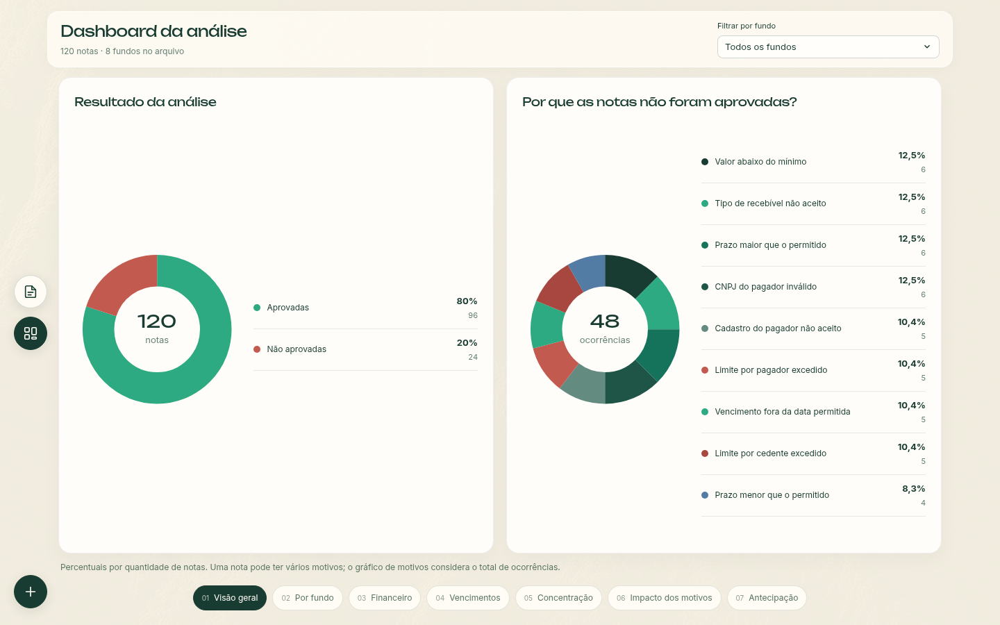
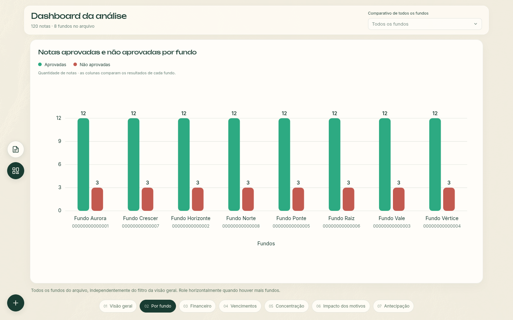
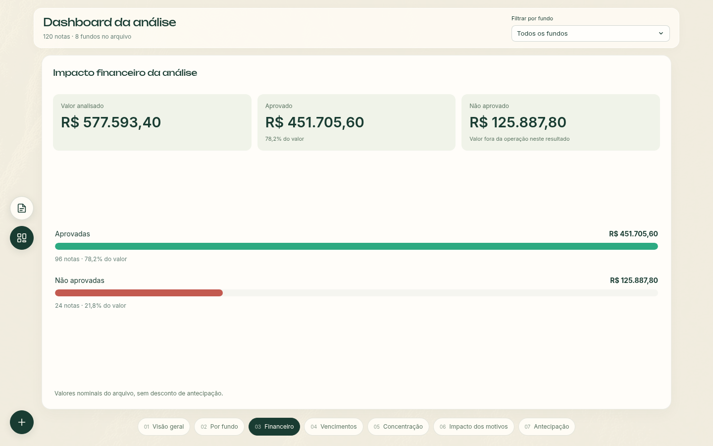
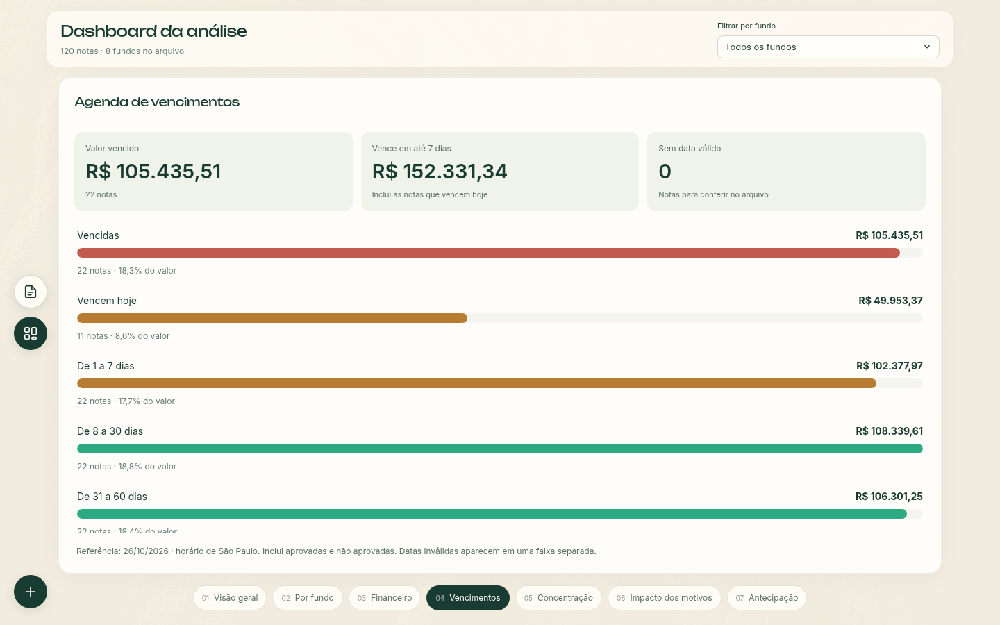
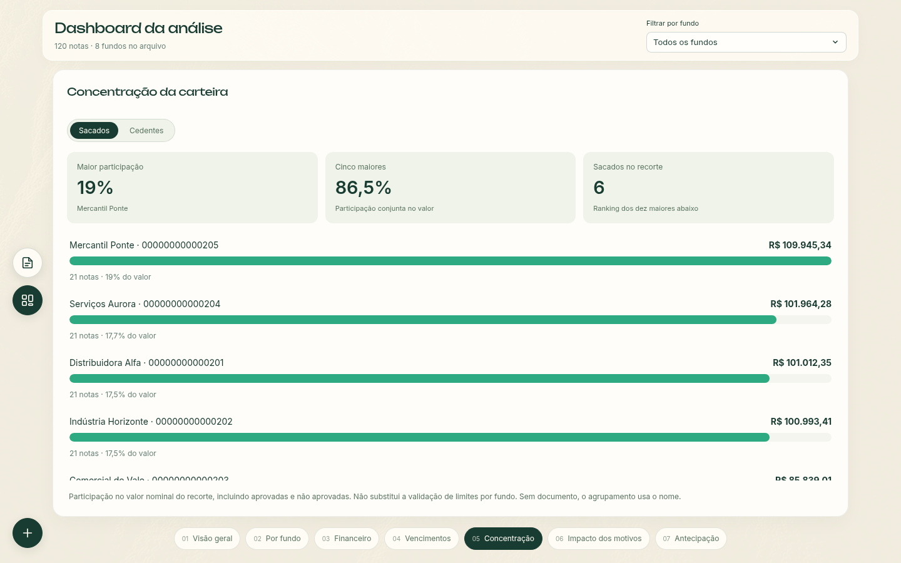
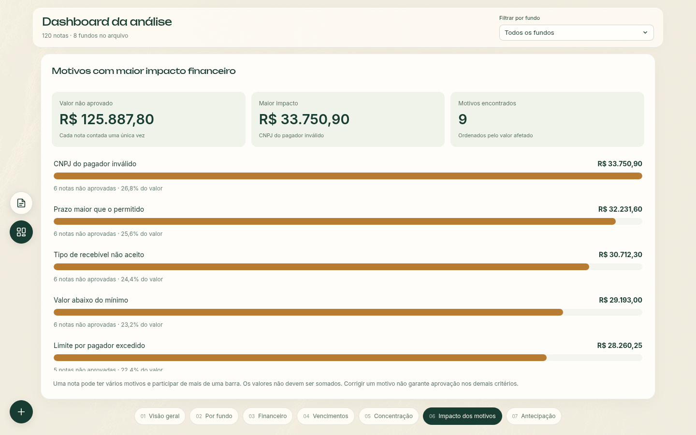
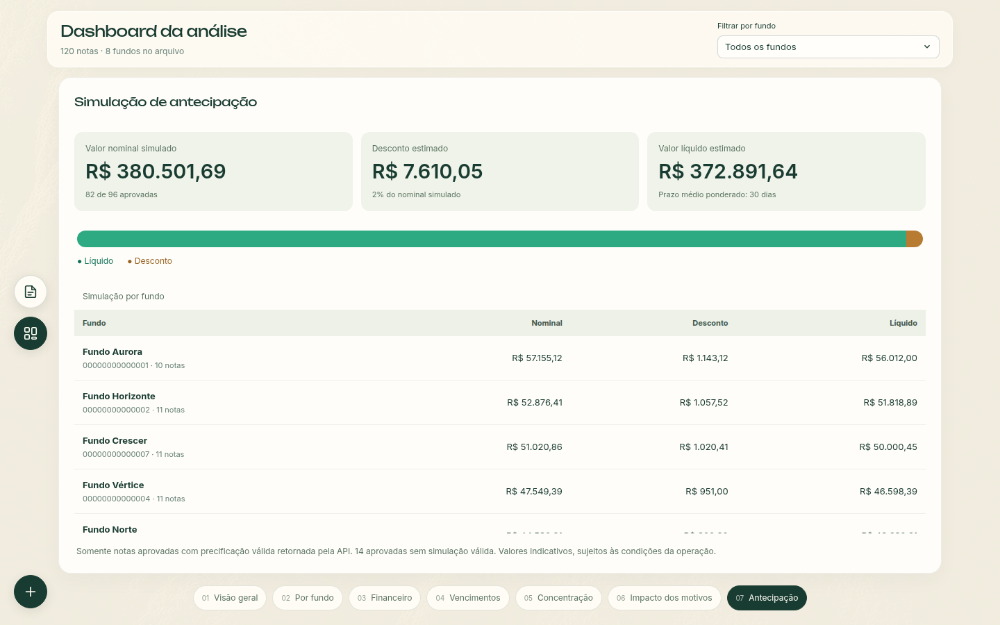
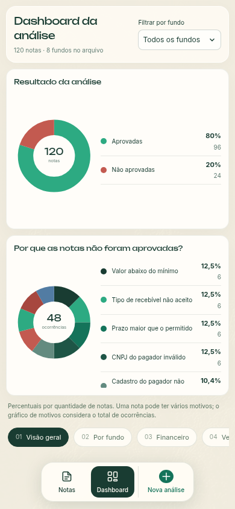
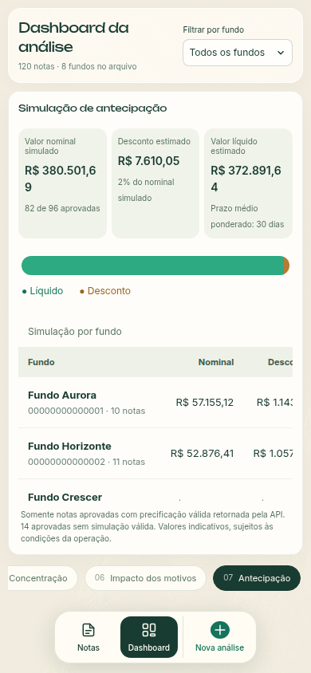

# Dashboard com troca de painéis

O dashboard ocupa a janela e tem sete painéis:

1. **Visão geral:** gráficos de pizza com o resultado das notas e os motivos de não aprovação.
2. **Por fundo:** gráfico de colunas comparando aprovadas e não aprovadas em todos os fundos do arquivo.
3. **Financeiro:** valores nominais aprovados e não aprovados, com participação em reais.
4. **Vencimentos:** faixas de vencimento relativas ao dia atual em São Paulo, incluindo vencidas, hoje e datas inválidas.
5. **Concentração:** ranking de sacados ou cedentes, dez maiores e demais participantes, com identificação por documento quando disponível.
6. **Impacto dos motivos:** recusas ordenadas pelo valor nominal afetado. Uma nota pode aparecer em mais de um motivo; as barras não são somáveis.
7. **Antecipação:** nominal, desconto e líquido somente das aprovadas com precificação válida da API, prazo médio ponderado e comparativo por fundo. A cobertura da simulação e os dados ausentes ficam explícitos.

Rolar para baixo avança um painel; rolar para cima volta ao anterior. A navegação para nos limites do primeiro e último painéis. A transição combina opacidade e deslocamento, com bloqueio temporário para evitar trocas causadas pela inércia do scroll. A preferência por movimento reduzido remove a animação.

Os sete botões no rodapé permitem selecionar diretamente o painel desejado. Com a área dos gráficos em foco, use as setas, Page Up, Page Down, Home, End ou espaço; Home vai ao primeiro painel, End ao último e Shift + espaço volta um painel. No celular, deslizar para cima ou para baixo também troca os painéis.

Legendas, listas e comparativos têm rolagem interna. O scroll com o mouse sobre essas áreas nunca troca o painel, inclusive no início e no fim da lista ou quando o conteúdo cabe inteiro. Fora dessas áreas, o scroll continua navegando entre os painéis. No comparativo de colunas, a roda do mouse move o gráfico horizontalmente quando há fundos fora da área visível: para baixo avança à direita e para cima volta à esquerda. Movimentos horizontais nativos e Shift + scroll continuam disponíveis.

O filtro por fundo é aplicado à visão geral e aos cinco novos painéis. O botão abre um modal compartilhado com os filtros de Notas, com busca por nome ou CNPJ, opção Todos os fundos e indicação da seleção atual. Escolher aplica o filtro e fecha; cancelar, Esc ou clicar fora mantém a seleção. No comparativo, o seletor indica todos os fundos e fica desabilitado; ao voltar, a seleção anterior é mantida. Os eixos de quantidade usam valores inteiros.

Ao alternar entre Notas e Dashboard, o último painel de gráficos, a página da tabela e sua posição de rolagem são mantidos durante a análise atual. Alterar filtros reinicia a paginação das notas; uma nova análise reinicia a navegação. O cabeçalho do dashboard acompanha as dimensões do topo compacto de Notas no desktop, e os seletores de gráficos ficam centralizados também em telas grandes.

No celular, a navegação entre **Notas**, **Dashboard** e **Nova análise** fica em uma barra flutuante centralizada no rodapé, com ícones e nomes sempre visíveis. O seletor dos sete painéis permite rolagem horizontal e mantém a opção ativa à vista. O dashboard reserva espaço abaixo dos controles para essa barra e para a área segura do dispositivo.

## Verificação

- Lint e compilação de produção concluídos.
- Conferência inicial com upload real de 75 notas.
- Respostas controladas com 120 notas, oito fundos e nove motivos de não aprovação para verificar filtros, legendas extensas e comparativos.
- Scroll nos dois sentidos, transição intermediária de opacidade, bloqueio de inércia, teclado, gestos touch enviados ao Chrome e movimento reduzido.
- Viewports de 1440 × 900, 1024 × 600, 390 × 844 e 320 × 568 sem scroll externo horizontal ou vertical.
- Retorno às Notas e início de nova análise, sem erros JavaScript no fluxo verificado.
- Alternância repetida entre o comparativo e a página 3 das notas, preservando painel, paginação e rolagem; filtros e nova análise reiniciam as posições correspondentes.

## Capturas

Renovadas em 26/10/2026 com 120 notas sintéticas, oito fundos, 96 aprovadas e 24 não aprovadas. As respostas são controladas no navegador e não representam resultados reais de validação. O [guia da interface](interface.md) explica a geração e identifica os 20 prints; o [manifesto](capturas-interface.json) registra data e dimensões.

### 1. Visão geral

### 2. Por fundo

### 3. Financeiro

### 4. Vencimentos

### 5. Concentração

### 6. Impacto dos motivos

### 7. Antecipação

### Seleção de fundo e celular

[Modal no desktop](filtro-fundo-desktop.png) · [Modal no celular](filtro-fundo-mobile.png)

## Cálculos e validação dos novos painéis

Valores monetários são acumulados em centavos. Valores nominais negativos ou não finitos são excluídos dos totais financeiros, com aviso no painel Financeiro. Datas impossíveis não são convertidas para outro dia. Motivos repetidos na mesma nota contam uma vez por categoria. A simulação rejeita preços ausentes ou inconsistentes, sem inventar precificação para as notas.

Testes: `node --test front/tests/*.test.mjs` com Node 24. Os testes cobrem totais, faixas e fuso de datas, concentração, motivos sobrepostos e simulação parcial. A conferência no navegador percorreu os sete painéis em quatro tamanhos (de 320 × 568 a 1440 × 900), filtro financeiro, precificação parcial, teclado, memória e ausência de scroll externo.
