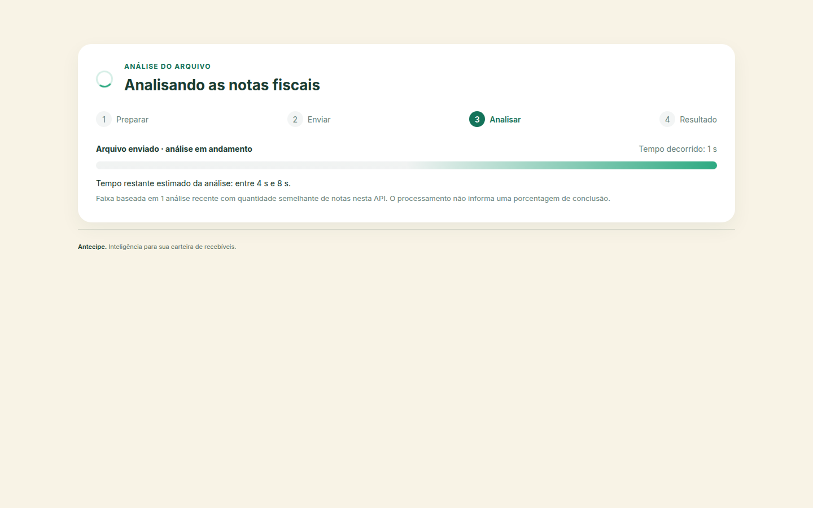

# Estimativa de tempo da análise

A interface separa preparação, envio, processamento e recebimento. A porcentagem representa somente bytes transferidos. O processamento continua com indicador indeterminado, pois a API não expõe progresso por nota.

## Histórico e faixa de tempo

A estimativa de processamento usa a quantidade de notas, em vez de extrapolar somente os bytes do último arquivo. O navegador guarda até dez medições válidas dos últimos sete dias, separadas por endereço da API. Cada medição contém apenas quantidade de notas, duração e data; não guarda o arquivo nem dados das notas.

Até cinco medições próximas ao tamanho atual entram no cálculo, limitadas a lotes entre um quarto e quatro vezes a quantidade atual. As durações são ajustadas pela quantidade de notas. A faixa usa quantis com margem para variação e elimina durações extremas quando há pelo menos três observações. É uma heurística local, não uma garantia estatística de prazo.

Sem histórico comparável, a interface informa que ainda está aprendendo o tempo dos lotes. A faixa restante diminui durante o processamento. Ao ultrapassar o limite superior, a interface informa que a análise continua além da previsão. Não cria porcentagens nem contagens negativas.

O armazenamento pode estar bloqueado ou cheio sem impedir o envio: nesse caso, o histórico funciona apenas durante a sessão atual. Medições de solicitações com erro não são salvas.

## Transferência e medição

Envio e recebimento usam a velocidade recente dos eventos de transferência, com janela de cinco segundos. Sem progresso recente por oito segundos, a estimativa da transferência é suspensa até novos dados. Ao concluir os bytes, a interface indica a finalização da etapa.

O tempo observado de processamento começa quando o upload termina e termina quando os cabeçalhos da resposta chegam (`HEADERS_RECEIVED`). Isso evita incluir todo o download da resposta na medição da análise. O valor observado ainda pode incluir latência e preparação da resposta pelo servidor; não representa uma medição isolada de CPU.

## Captura da interface

Captura demonstrativa de 26/10/2026. Histórico e atraso HTTP controlados para mostrar a faixa; não é uma medição de desempenho real. O [manifesto](capturas-interface.json) e o [guia da interface](interface.md) descrevem a geração.

## Verificação

- `npm test --prefix front`, com Node 24: nove testes dos cálculos dos painéis, histórico, estimativas e velocidade recente.
- Lint e build do frontend.
- Navegador com servidor HTTP local e atraso controlado: primeiro lote sem histórico, processamento indeterminado, medição até os cabeçalhos, persistência após recarga, faixa de tempo, previsão ultrapassada e erro sem gravar amostra.
