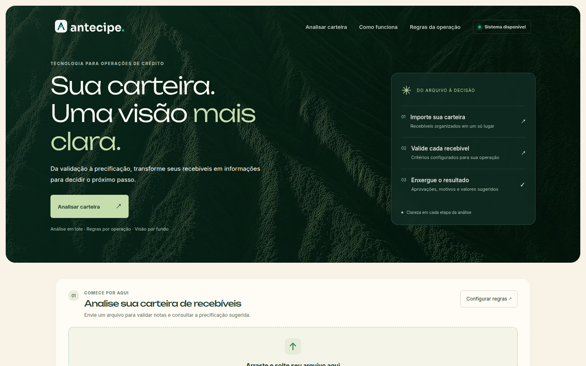
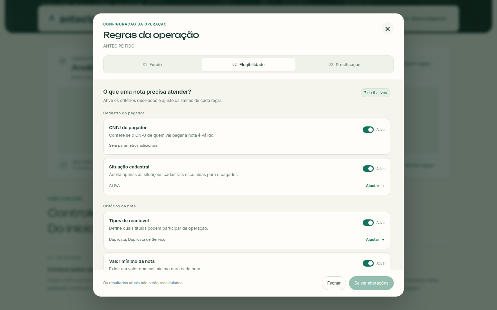
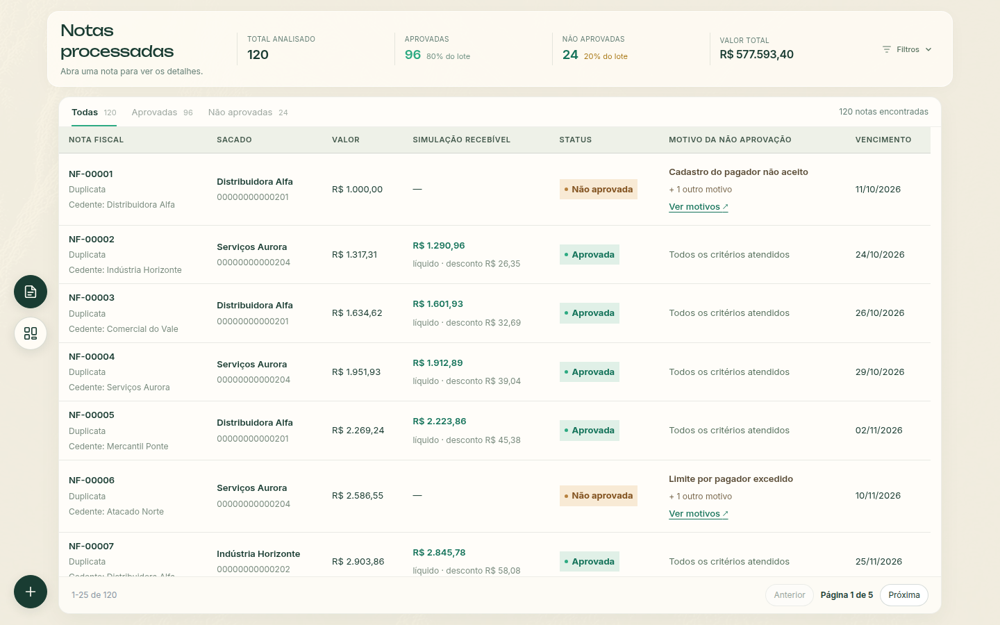
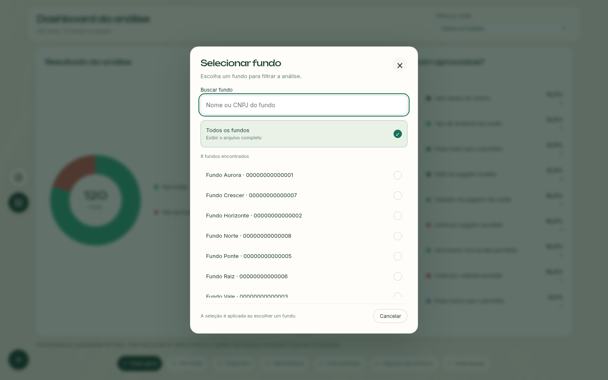

# Interface atual do Antecipe

O fluxo começa no envio de um CSV, passa pela validação e permite alternar entre Notas e Dashboard. As telas abaixo foram renovadas em 26/10/2026. O [manifesto das capturas](capturas-interface.json) registra os arquivos, as dimensões e o horário da geração.

## Sobre os prints

Os prints usam **120 notas sintéticas de oito fundos**, com 96 aprovadas e 24 não aprovadas. Nomes e documentos são demonstrativos. As respostas de análise e de consulta das regras são controladas no navegador; os prints não comprovam a execução das regras do backend nem representam uma carteira real. A agenda de vencimentos usa a data de referência registrada no manifesto, no fuso de São Paulo.

A preferência por movimento reduzido foi ativada para capturar estados estáveis. A abertura mostra a capa do vídeo; no uso normal, o vídeo reproduz sem som, em loop, e desaparece durante a rolagem. O modal de regras usa uma cópia da configuração local e não salva alterações na API. Na captura de processamento, o histórico de tempo e o atraso HTTP também são controlados para demonstrar a faixa prevista.

## Página inicial e upload

O cabeçalho é fixo na página inicial e muda do fundo transparente para creme ao rolar. A área de upload inteira abre a seleção de arquivo. O status de disponibilidade usa `/health`. Durante a análise e nos resultados, a topbar é removida.



[Upload e cabeçalho após rolagem](topbar-rolagem.png) · [Página inicial no celular](pagina-inicial-mobile.png)

## Equipe e código do projeto

No fim da página inicial, a seção **Quem constrói o Antecipe** mostra Samuel Victor Alventino Silva, Matheus Filipe e David de Oliveira. Cada cartão leva ao perfil do integrante no GitHub, e o botão **Ver projeto no GitHub** abre o repositório. Os links abrem em uma nova aba, têm identificação por teclado e leitor de tela e não aparecem nas telas de análise.

[Equipe no desktop](equipe-desktop.png) · [Equipe no celular](equipe-mobile.png) · [Integrantes e perfis verificados](../README.md#equipe-responsável)

## Configuração das regras da operação

O modal tem três abas: **Fundo**, **Elegibilidade** e **Precificação**. Cabeçalho, abas e ações permanecem visíveis; apenas o corpo rola. As regras são agrupadas em cadastro do pagador, critérios da nota e concentração da carteira, com descrição simples, controle de ativação e resumo dos parâmetros.

O botão Ajustar abre os parâmetros de uma regra. Tipos de recebível e situações cadastrais são escolhidos por opções, sem digitar listas separadas por vírgula. Parâmetros de regras inativas podem ser preparados antes de ativá-las. A aba Precificação mostra um exemplo ilustrativo para uma nota de R$ 1.000,00 com prazo de 30 dias.

Salvar fica disponível quando há alterações. A validação abre a aba e o parâmetro com problema, inclusive se estiver recolhido. Durante o salvamento, edição e fechamento ficam bloqueados para evitar envios simultâneos. Erros preservam as alterações para uma nova tentativa, e o sucesso informa que apenas as próximas análises usarão as regras salvas.



[Parâmetros de uma regra](regras-parametros-desktop.png) · [Precificação e exemplo](regras-precificacao-desktop.png) · [Modal no celular](regras-operacao-mobile.png)

## Notas

No desktop a janela não rola: o cabeçalho compacto e o quadro principal são superfícies separadas. A tabela tem rolagem interna, cabeçalho de colunas fixo e paginação visível. Os filtros começam recolhidos; o botão discreto fica ao lado dos indicadores. No celular, o conteúdo adapta a largura e os atalhos aparecem em uma barra inferior flutuante.



[Filtros expandidos](notas-filtros-desktop.png) · [Notas no celular](notas-mobile.png) · [Detalhes de não aprovação](resultados-nao-aprovados.md)

## Dashboard

Há sete painéis: Visão geral, Por fundo, Financeiro, Vencimentos, Concentração, Impacto dos motivos e Antecipação. O dashboard ocupa a janela e troca de painel por scroll nas áreas externas às listas, por botões, teclado ou gestos touch.

As listas e legendas preservam a rolagem interna e nunca transferem o scroll para outro painel, mesmo nas extremidades. No gráfico de colunas, a roda do mouse percorre os fundos horizontalmente. Os seletores de painéis ficam centralizados no desktop; no celular, têm rolagem horizontal para acessar todas as opções.


Consulte os [sete painéis e seus cálculos](dashboard.md), incluindo limitações dos valores financeiros e da simulação.

## Seleção de fundo

O filtro compartilhado entre Notas e Dashboard abre um modal com busca por nome ou CNPJ. A escolha aplica o filtro e fecha. Cancelar, Esc e clique no fundo do modal preservam a seleção anterior. O modal indica o fundo atual, mantém o foco por teclado e devolve o foco ao botão quando fecha.

O comparativo Por fundo sempre usa todos os fundos: o botão fica desabilitado nesse painel e a seleção anterior reaparece ao retornar aos demais.



[Modal no celular](filtro-fundo-mobile.png)

## Navegação e memória

No desktop, os atalhos Notas e Dashboard ficam à esquerda, suspensos sobre a página, e Nova análise fica no canto inferior esquerdo. No celular, as três ações ficam agrupadas no rodapé, com ícones e rótulos visíveis. O dashboard reserva espaço para não cobrir os gráficos.

A alternância mantém o painel do dashboard, a página da tabela e a posição de rolagem. Alterações nos filtros reiniciam a paginação; Nova análise reinicia a navegação. Essa memória vale para a análise em andamento, sem restaurar o arquivo após recarregar a página.


## Estimativa de tempo

Envio e recebimento mostram progresso de transferência. O processamento mostra uma faixa baseada em medições recentes de lotes semelhantes, sem inventar porcentagem de conclusão. O histórico de medições persiste no navegador, separado por API.


Veja [como a estimativa é calculada e seus limites](estimativa-tempo.md).

## Catálogo das capturas atuais

| Arquivo | Estado | Dimensões |
| --- | --- | --- |
| [pagina-inicial.png](pagina-inicial.png) | Abertura | 1440 × 900 |
| [equipe-desktop.png](equipe-desktop.png) | Equipe e repositório | 1440 × 900 |
| [equipe-mobile.png](equipe-mobile.png) | Equipe no celular | 390 × 844 |
| [topbar-rolagem.png](topbar-rolagem.png) | Cabeçalho após rolagem e upload | 1440 × 900 |
| [pagina-inicial-mobile.png](pagina-inicial-mobile.png) | Abertura no celular | 390 × 844 |
| [regras-operacao-desktop.png](regras-operacao-desktop.png) | Elegibilidade no modal de regras | 1440 × 900 |
| [regras-parametros-desktop.png](regras-parametros-desktop.png) | Parâmetros de uma regra | 1440 × 900 |
| [regras-precificacao-desktop.png](regras-precificacao-desktop.png) | Precificação e exemplo | 1440 × 900 |
| [regras-operacao-mobile.png](regras-operacao-mobile.png) | Regras no celular | 390 × 844 |
| [pagina-notas.png](pagina-notas.png) | Notas, filtros recolhidos | 1440 × 900 |
| [notas-filtros-desktop.png](notas-filtros-desktop.png) | Filtros expandidos | 1440 × 900 |
| [notas-mobile.png](notas-mobile.png) | Notas no celular | 390 × 844 |
| [notas-nao-aprovadas-desktop.png](notas-nao-aprovadas-desktop.png) | Motivos de uma nota | 1440 × 900 |
| [notas-nao-aprovadas-mobile.png](notas-nao-aprovadas-mobile.png) | Motivos no celular | 390 × 844 |
| [dashboard-paineis-pizzas.png](dashboard-paineis-pizzas.png) | Visão geral | 1440 × 900 |
| [dashboard-paineis-colunas.png](dashboard-paineis-colunas.png) | Por fundo | 1440 × 900 |
| [dashboard-financeiro.png](dashboard-financeiro.png) | Financeiro | 1440 × 900 |
| [dashboard-vencimentos.png](dashboard-vencimentos.png) | Vencimentos | 1440 × 900 |
| [dashboard-concentracao.png](dashboard-concentracao.png) | Concentração por sacado | 1440 × 900 |
| [dashboard-impacto-motivos.png](dashboard-impacto-motivos.png) | Ranking de motivos por valor | 1440 × 900 |
| [dashboard-antecipacao.png](dashboard-antecipacao.png) | Antecipação por fundo | 1440 × 900 |
| [filtro-fundo-desktop.png](filtro-fundo-desktop.png) | Modal de fundos | 1440 × 900 |
| [filtro-fundo-mobile.png](filtro-fundo-mobile.png) | Modal no celular | 390 × 844 |
| [dashboard-paineis-mobile.png](dashboard-paineis-mobile.png) | Visão geral no celular | 390 × 844 |
| [dashboard-antecipacao-mobile.png](dashboard-antecipacao-mobile.png) | Antecipação no celular | 390 × 844 |
| [processamento-estimativa.png](processamento-estimativa.png) | Faixa de tempo de processamento | 1440 × 900 |

As imagens JPEG antigas `pagina-*.jpeg` e as capturas em `docs/rea` permanecem como registros históricos. O README e este catálogo usam os prints atuais. Os anexos fornecidos pelo usuário estão separados em [prompts/referencias](prompts/referencias), vinculados ao [histórico deste chat](prompts/chat-interface.md).

## Como renovar os prints

Com o frontend iniciado, Node 24, Playwright e um Chromium disponíveis, execute a partir da raiz:

```bash
BASE_URL=http://127.0.0.1:5173 node front/scripts/capture-docs.mjs
```

O script usa o pacote `playwright` instalado. Para reaproveitar uma instalação existente de `playwright-core` e um Chrome local, informe `PLAYWRIGHT_MODULE_PATH` (caminho do módulo) e `CHROME_PATH` (caminho do executável). Ele gera os 26 prints e o manifesto em `docs/`, injeta somente respostas demonstrativas no navegador e não modifica as regras nem os dados do backend.
