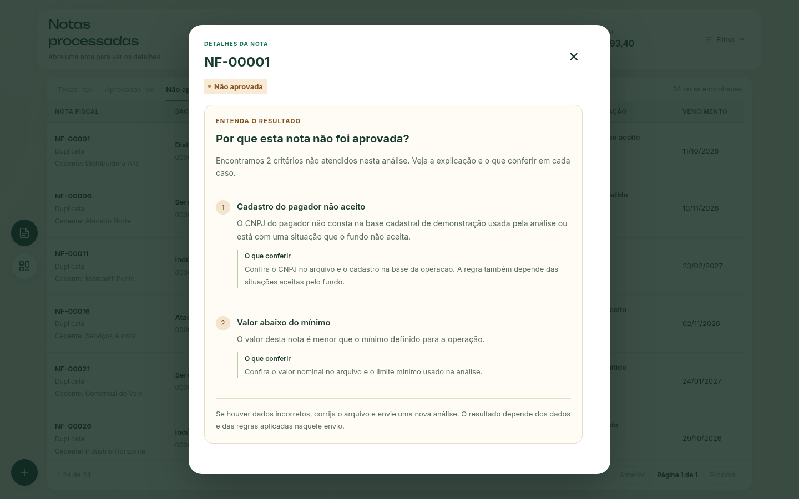
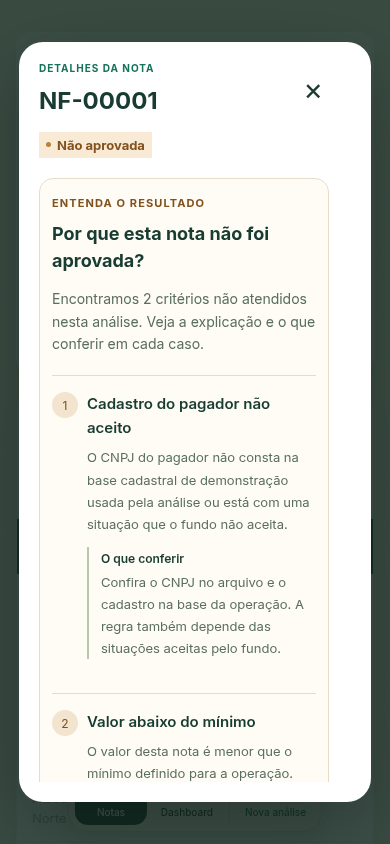

# Como as notas não aprovadas são apresentadas

A listagem usa o status **Não aprovada** e mostra o primeiro motivo em linguagem simples. Quando há outros motivos, exibe a quantidade e o botão **Ver motivos**.

O detalhe da nota abre com as explicações, antes dos dados cadastrais. Cada critério apresenta um título, uma descrição e uma orientação sobre o que conferir. Motivos repetidos são apresentados uma única vez. O texto explica quando um limite considera o lote inteiro do fundo, em vez de apenas a nota.

Os nove códigos de validação têm explicações próprias. Códigos desconhecidos recebem uma explicação genérica; ausência de motivo é informada explicitamente. O dashboard usa os mesmos títulos e agrupa motivos com a mesma descrição visual. A correção de dados e um novo envio não garantem aprovação: o resultado depende das regras e dos dados daquele envio.

As explicações de vencimento respeitam a referência histórica da API: no CSV, a comparação usa a data de aquisição.

## Telas

Capturas renovadas em 26/10/2026 com o layout atual de Notas. Usam 120 notas sintéticas e respostas controladas para demonstrar os estados da interface; não representam uma carteira real. Consulte o [guia e catálogo de capturas](interface.md) para o fluxo completo.

## Verificação

Lint e compilação de produção passaram. No Chrome, um upload real de 10 notas foi seguido pela abertura dos motivos. Respostas controladas cobriram motivo único, vários motivos, duplicações, regra desconhecida, motivo ausente e nota aprovada. Também foram conferidos os filtros, o agrupamento no dashboard e o modal no celular, sem overflow ou erros de JavaScript.
